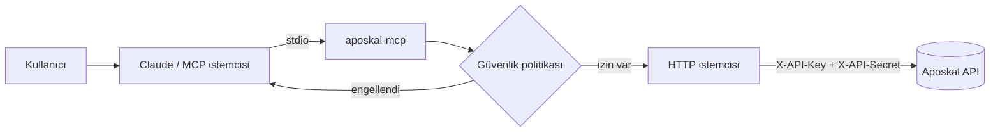

<div align="center">


# Aposkal MCP Server

**Aposkal muhasebe API'si için Model Context Protocol (MCP) sunucusu**

Geliştiren: **[Switas Consultancy](https://switas.com)**

[](LICENSE)
[](https://nodejs.org)
[](https://modelcontextprotocol.io)
[](https://vercel.com/new/clone?repository-url=https%3A%2F%2Fgithub.com%2Fswitaslabs%2Faposkal-mcp&env=APOSKAL_API_KEY,APOSKAL_API_SECRET,APOSKAL_ENV,MCP_AUTH_TOKEN&envDescription=Aposkal%20API%20bilgileri%20ve%20en%20az%2032%20karakterlik%20eri%C5%9Fim%20token%27%C4%B1&envLink=https%3A%2F%2Fgithub.com%2Fswitaslabs%2Faposkal-mcp%23vercele-kurulum)
[](https://switas.com)

</div>

---

**aposkal-mcp**, [Aposkal](https://aposkal.com) ön muhasebe ve muhasebe platformunu Claude gibi yapay zekâ asistanlarına bağlayan açık kaynak bir [MCP](https://modelcontextprotocol.io) sunucusudur. **[Switas Consultancy](https://switas.com)** tarafından geliştirilmekte ve sürdürülmektedir.

Asistanınıza "geçen ayın kâr-zarar raporunu çıkar", "vadesi geçmiş alacakları listele" ya da "bu müşteri e-Fatura mükellefi mi?" diye sorabilirsiniz. Sunucu doğru Aposkal API çağrısını yapar ve sonucu asistana iletir. Aposkal API'sinin sunduğu **430 operasyonun tamamına** erişilebilir. Varsayılan ayar **salt-okumadır**: siz açıkça izin vermeden hiçbir kayıt değişmez ve GİB'e ya da SGK'ya hiçbir şey gönderilmez.

> **Bağımsızlık notu:** Bu proje bağımsız bir topluluk entegrasyonudur. Aposkal'ın resmî ürünü değildir ve Aposkal tarafından onaylanmamıştır. "Aposkal" adı ve logosu sahibine aittir, burada yalnızca entegrasyonu tanımlamak için kullanılmıştır. Ayrıntılar için [NOTICE](NOTICE) dosyasına bakın.

## İçindekiler

1. [Öne çıkanlar](#öne-çıkanlar)
2. [Hızlı başlangıç](#hızlı-başlangıç)
3. [Nasıl çalışır](#nasıl-çalışır)
4. [Neler yapılabilir](#neler-yapılabilir)
5. [Neler yapılamaz (sınırlamalar)](#neler-yapılamaz-sınırlamalar)
6. [Güvenlik modeli](#güvenlik-modeli)
7. [Hazır araçlar](#hazır-araçlar)
8. [API grupları (toolset'ler)](#api-grupları-toolsetler)
9. [Yapılandırma](#yapılandırma)
10. [İstemcilere kurulum](#istemcilere-kurulum)
11. [Vercel'e kurulum](#vercele-kurulum)
12. [Örnek istemler](#örnek-istemler)
13. [Doğrulama durumu](#doğrulama-durumu)
14. [Sorun giderme](#sorun-giderme)
15. [Geliştirme ve katkı](#geliştirme-ve-katkı)
16. [Hakkında](#hakkında)

---

## Öne çıkanlar

- **Tam API kapsamı.** Aposkal'ın OpenAPI 3.1 tanımındaki 52 gruptaki 430 operasyonun hepsi erişilebilir.
- **Bağlamı şişirmez.** Varsayılan olarak yalnızca 10 araç yüklenir. Diğer operasyonlara keşif araçlarıyla ulaşılır, ya da istenen gruplar ayrı araç olarak açılır.
- **Güvenli varsayılanlar.** Beş seviyeli risk politikası vardır. Salt-okuma varsayılandır. GİB/SGK işlemleri ayrı bir bayrakla açılır ve kullanıcı onayı (`confirm`) ister.
- **Aposkal kurallarını bilir.** Doğru fatura senaryosunun seçimi, kesirli oranlar (%20 → `0.2`), zorunlu belge düzeyi vergi ve TAHSILAT yön kuralı kodda çözülür.
- **Tamamen Türkçe.** 430 operasyonun özetleri ve açıklamaları, araç açıklamaları, hata mesajları ve loglar Türkçedir. Aposkal'ın İngilizce API metinlerinin yerine Türkçe karşılıkları kullanılır ([`i18n/aposkal-tr.json`](i18n/aposkal-tr.json)).
- **Türkçe arama.** "fatura indir", "cari bakiye", "bordro" gibi sorgular doğrudan eşleşir.
- **Yerelde veya Vercel'de.** Bilgisayarınızda yerel süreç (stdio) olarak ya da token korumalı uzak sunucu (Streamable HTTP) olarak Vercel'de çalışır.
- **Canlıda test edildi.** Okuma araçları canlı Aposkal ortamında denendi (bkz. [Doğrulama durumu](#doğrulama-durumu)).

## Hızlı başlangıç

Gereksinim: **Node.js 20 veya üstü** ve bir Aposkal API anahtarı (Key + Secret).

**1. Projeyi indirin ve derleyin**

```bash
git clone https://github.com/switaslabs/aposkal-mcp.git
```

```bash
cd aposkal-mcp && npm ci && npm run build
```

**2. API anahtarı oluşturun.** Aposkal'da **Profil → Api Anahtarları** sayfasından bir Key/Secret ikilisi oluşturun.

> Anahtar, onu oluşturan kullanıcının rolünü taşır (USER, ADMIN, OWNER, ACCOUNTANT). Yalnızca okuma yapacaksanız düşük yetkili bir kullanıcıyla anahtar oluşturmanız önerilir. Test ortamı (`api.dev.aposkal.com`) için ayrı bir anahtar gerekir.

**3. Asistanınıza ekleyin.** Örneğin Claude Code için:

```bash
claude mcp add aposkal -e APOSKAL_ENV=live -e APOSKAL_API_KEY=... -e APOSKAL_API_SECRET=... -- node /tam/yol/aposkal-mcp/dist/index.js
```

Diğer istemciler için [İstemcilere kurulum](#istemcilere-kurulum) bölümüne bakın.

**4. Deneyin:** *"Aposkal'daki firmalarımı listele."*

## Nasıl çalışır



Sunucu üç katmanlı araç yapısı sunar:

| Katman | Araçlar | Ne zaman kullanılır |
|---|---|---|
| **Hazır iş akışı araçları** | `aposkal_list_companies`, `aposkal_create_sales_invoice_draft`… | Sık yapılan işler. Doğrulama ve hesaplama sunucuda yapılır. |
| **Keşif araçları** | `aposkal_search_endpoints`, `aposkal_describe_endpoint`, `aposkal_call_endpoint` | API'deki herhangi bir operasyona ulaşmak için. Asistan önce arar, sonra şemayı okur, sonra çağırır. |
| **Üretilmiş araçlar (isteğe bağlı)** | `aposkal_get_documents`, `aposkal_create_product`… | `APOSKAL_TOOLSETS` ile açılan gruplardaki her operasyon kendi aracını alır. |

Hangi yoldan gelirse gelsin her çağrı aynı güvenlik politikasından geçer.

## Neler yapılabilir

Aşağıdaki tabloda her alanda neler yapılabildiği ve bunun hangi ayarla açıldığı özetlenmiştir. **Okuma** işlemleri her zaman açıktır. **Yazma** için `APOSKAL_MODE=write`, **silme** için `full` gerekir. **GİB/SGK** ve **hassas** işlemler ayrı bayraklar ister (bkz. [Güvenlik modeli](#güvenlik-modeli)).

### Firma ve kullanıcı

| İşlem | Durum |
|---|---|
| Erişilebilen firmaları, VKN'yi ve anahtarın rolünü listeleme | ✅ Varsayılan |
| Firma bilgileri, firma kullanıcıları ve yapılandırmayı görüntüleme | ✅ Varsayılan |
| Firma bilgisi, ayar ve entegrasyon değiştirme, profil güncelleme | 🔒 Hassas (`APOSKAL_ALLOW_SENSITIVE`) |

### Cari hesaplar, kasa ve banka

| İşlem | Durum |
|---|---|
| Cari, kasa, banka, POS ve personel hesaplarını arama ve listeleme | ✅ Varsayılan |
| Cari bakiyesi, muavin (ekstre), irsaliye listesi, ödeme linkleri | ✅ Varsayılan |
| VKN/TCKN ile cari bulma, GİB mükellef bilgisi sorgulama | ✅ Varsayılan |
| Cari ve adres oluşturma/güncelleme, cariler arası bakiye transferi | ✍️ Yazma |
| Cari ve adres silme | 🗑️ `full` + onay |
| Müşteriye ödeme talebi (link) gönderme | 🌐 Dış işlem + onay |

### Belgeler ve faturalar

| İşlem | Durum |
|---|---|
| Belgeleri filtreli listeleme (senaryo, durum, tarih, etiket…) ve detay görüntüleme | ✅ Varsayılan |
| Belge PDF/XML/HTML için geçici indirme linki | ✅ Varsayılan |
| Taslak sayısı, seri boşlukları, sonraki belge numarası tahmini | ✅ Varsayılan |
| Satış faturası taslağı (senaryo, KDV ve toplam otomatik) | ✍️ Yazma (`aposkal_create_sales_invoice_draft`) |
| Belge oluşturma/güncelleme, kopyalama, iade belgesi, tekrarlayan belge | ✍️ Yazma |
| Belge arşivleme, etiket ve not ekleme | ✍️ Yazma |
| Belge veya ödeme satırı silme | 🗑️ `full` + onay |
| **Resmileştirme (GİB'e gönderme)**, iptal, iptali geri alma, matbu numaralandırma | 🌐 Dış işlem + onay |
| Belgeyi e-posta ile paylaşma, doğrulama kodu üretme | 🌐 Dış işlem + onay |

### e-Fatura, e-Arşiv, e-İrsaliye ve gelen kutusu

| İşlem | Durum |
|---|---|
| Alıcının e-Fatura / e-İrsaliye mükellefi olup olmadığını sorgulama ve önerilen senaryo | ✅ Varsayılan |
| Gelen kutusunu listeleme, gelen e-faturanın detayını ve GİB verisini görüntüleme | ✅ Varsayılan |
| Gelen faturaları Aposkal belgesine dönüştürme (import), arşivleme, ürün eşleştirme | ✍️ Yazma |
| Bekleyen tüm gelen faturaları toplu içe alma | 🗑️ `full` + onay |
| Gelen ticari faturaya **kabul / red / kısmi kabul** yanıtı | 🌐 Dış işlem + onay |

### Muhasebe

| İşlem | Durum |
|---|---|
| Muhasebe kayıtları, **mizan**, muavin, KDV raporu, dönem özeti | ✅ Varsayılan |
| Hesap planı, kullanılmayan hesaplar, kural grupları, amortisman önizleme | ✅ Varsayılan |
| Fiş kaydetme, KDV/virman/kapanış/açılış fişi üretme, kayıt onaylama | ✍️ Yazma |
| Hesap planı kalemi oluşturma/güncelleme | ✍️ Yazma |
| Kayıtları geri alma, öğrenilmiş kuralları silme, tüm taslakları yeniden üretme, toplu onay | 🗑️ `full` + onay |

> Muhasebe kayıtları uçları Aposkal'da yükseltilmiş rol (ADMIN, OWNER veya ACCOUNTANT) ister. Anahtarınızın rolü yetmezse API `403` döner.

### Banka hareketleri, çek ve POS

| İşlem | Durum |
|---|---|
| Banka hareketlerini arama, virman adayları, bekleyen ön muhasebe kayıtları | ✅ Varsayılan |
| Banka hareketlerini kaydetme, etikete göre toplu kaydetme, POS komisyonu, çek tahsili | ✍️ Yazma |
| Tahsilat kaydı (kasa/banka) | ✍️ Yazma (`aposkal_create_collection`) |

### Ürün, stok ve depo

| İşlem | Durum |
|---|---|
| Ürün listesi, stok miktarları, ürün ekstresi, depo bazlı stok raporu | ✅ Varsayılan |
| Ürün, üretim kaydı, depo ve stok transferi oluşturma/güncelleme | ✍️ Yazma |
| Ürün, depo ve transfer silme | 🗑️ `full` + onay |

### Sipariş ve satış teklifi

| İşlem | Durum |
|---|---|
| Sipariş ve teklifleri listeleme, PDF alma | ✅ Varsayılan |
| Sipariş/teklif oluşturma, onaylama, faturaya veya irsaliyeye dönüştürme | ✍️ Yazma |
| Sipariş/teklif iptali, teklif reddi, silme | 🗑️ `full` + onay |
| Teklifi müşteriye **gönderme** | 🌐 Dış işlem + onay |

### Bordro, personel ve SGK

| İşlem | Durum |
|---|---|
| Bordro, icmal, bordro satırları, puantaj, personel listesi | ✅ Varsayılan |
| SGK tescil durumu, bildirge listesi, vizite raporları, iş kazası kayıtları | ✅ Varsayılan |
| Bordro dönemi oluşturma, hesaplama, onaylama, personel ve puantaj kaydı | ✍️ Yazma |
| SGK bildirge **gönderme / iptal / yeniden gönderme**, vizite bildirimi, SGK sorgusu | 🌐 Dış işlem + onay |

### Raporlar

| İşlem | Durum |
|---|---|
| Kâr-zarar, kâr trendi, nakit akışı, varlıklar | ✅ Varsayılan |
| Cari ve ödeme bazlı satış, gider raporu, ürün raporu, belge satırı raporu | ✅ Varsayılan |
| Vadesi geçmiş alacak/borçlar, stopaj ödemeleri, yapılacaklar listesi | ✅ Varsayılan |

### Dijital Beyan Sistemi (DBS)

| İşlem | Durum |
|---|---|
| Defter listesi, mükellef bilgileri, aktarılabilir belgeler, sistem kodları | ✅ Varsayılan |
| Belgeyi DBS'ye **aktarma / DBS'den silme** | 🌐 Dış işlem + onay |

### Diğer

| İşlem | Durum |
|---|---|
| Döviz kurları, vergi ve adres tanımları, genel arama | ✅ Varsayılan |
| Kategori, etiket, not şablonu, işyeri, departman, Ar-Ge projesi yönetimi | ✍️ Yazma |
| Kira, gider pusulası ve Z raporu belgeleri | ✍️ Yazma |
| Destek talebi açma/yanıtlama | 🌐 Dış işlem + onay |
| Webhook, SSO bileti, toplu veri silme (data-purge), ödeme başlatma, bayi müşterisi ekleme | 🔒 Hassas |

## Neler yapılamaz (sınırlamalar)

### Bilinçli güvenlik kısıtları

- **Varsayılan olarak hiçbir şey değiştirilemez.** Sunucu `readonly` modda başlar. Yazma ve silme için `APOSKAL_MODE` değiştirilmelidir.
- **Hazır araçlar asla resmileştirmez.** `aposkal_create_sales_invoice_draft` ve `aposkal_create_collection` yalnızca Aposkal içinde kayıt oluşturur. Bir faturayı GİB'e göndermek ayrı bir işlemdir: `APOSKAL_ALLOW_EXTERNAL=true` ve açık kullanıcı onayı (`confirm: true`) gerektirir.
- **Asistan kendi kendine onay veremez.** Riskli işlemlerde `confirm` alanı zorunludur ve yalnızca `true` değeri kabul edilir. Sunucu talimatları, asistanın bu değeri kullanıcı onayından önce göndermemesini ister. Yine de onay isteklerini dikkatle okuyun.
- **İzin verilmeyen firmalara erişilemez.** `APOSKAL_COMPANY_IDS` ayarlıysa listede olmayan firmalara yapılan her çağrı reddedilir.
- **Rastgele dosya yüklenemez.** Dosya yükleme varsayılan olarak kapalıdır. Açıldığında yalnızca `APOSKAL_UPLOAD_DIR` içindeki dosyalar yüklenebilir.
- **Başka sunuculara istek atılamaz.** API adresi sabittir. Yönlendirmeler yalnızca `https://*.aposkal.com` adreslerine kabul edilir.

### Teknik sınırlamalar

- **Uzak modda tek token.** Vercel kurulumunda erişim tek bir paylaşılan token ile korunur. Kullanıcı bazlı oturum açma (OAuth) henüz yok; token'ı bilen herkes sunucunun tüm yetkileriyle işlem yapar.
- **Uzak mod durumsuzdur.** Oturum tutulmaz, sunucudan istemciye bildirim akışı (SSE) yoktur. Her istek yalnızca POST ile yapılır.
- **Tek anahtar, tek kullanıcı.** Her sunucu örneği tek bir API anahtarıyla çalışır ve o anahtarın kullanıcısının yetkilerini taşır.
- **Büyük yanıtlar kırpılır.** Asistana dönen yanıt `APOSKAL_MAX_RESPONSE_CHARS` (varsayılan 60.000 karakter) ile sınırlıdır. Uzun listelerde `page` ve `size` parametrelerini kullanın.
- **İkili dosyalar asistana gönderilmez.** Yerel modda PDF gibi dosyalar `APOSKAL_DOWNLOAD_DIR` klasörüne kaydedilir ve asistana yalnızca dosya yolu bildirilir. Vercel'de dosya sistemi geçici olduğu için kaydedilmez. Belge indirme uçları her iki modda da geçici, imzalı bir CDN linki döndürür.
- **Yazma işlemleri otomatik tekrar denenmez.** Bu, mükerrer kaydı önlemek içindir. Bir yazma isteği zaman aşımına uğrarsa işlemin uygulanıp uygulanmadığını kontrol edip öyle tekrar deneyin.
- **Webhook olayları alınamaz.** Sunucu webhook tanımlayabilir (hassas işlem) ama Aposkal'dan gelen olayları dinleyen bir uç sunmaz.
- **Gövde şemaları sunucuda doğrulanmaz.** Parametre adları, tipleri ve yol değerleri denetlenir. Gövdenin içeriği ise Aposkal tarafından doğrulanır ve hatalar `400` olarak döner.
- **`APOSKAL_TOOLSETS=all` her istemciye uygun değildir.** 442 araç ve yaklaşık 340 KB şema demektir. Birçok istemci bu kadar araçta zorlanır, ihtiyaç duyulan grupları seçmeniz önerilir.
- **npm paketi henüz yayımlanmadı.** Şimdilik kaynak koddan derleyerek kurulur.

### API'den kaynaklanan sınırlamalar

- **Aposkal API'sinin sunmadığı hiçbir şey yapılamaz.** Sunucu yalnızca API'deki operasyonları çağırır.
- **Rol kısıtları API tarafından uygulanır.** Silme, muhasebe kayıtları ve firma ayarları yükseltilmiş rol ister. GİB'e gönderim `GIB_SUBMIT` ya da ADMIN/OWNER/ACCOUNTANT ister.
- **Test ve canlı anahtarlar ayrıdır.** Test ortamında oluşturulan belgeler GİB'e gitmez ama test anahtarı canlıda çalışmaz.
- **Senaryo sonradan değiştirilemez.** Fatura senaryosu taslak oluşturulurken seçilir. e-Fatura mükellefine e-Arşiv taslağı açılamaz. Hazır fatura aracı bu yüzden önce mükellef sorgusu yapar.
- **Bazı uçlar yalnızca web oturumu için belgelenmiştir.** OpenAPI'de 27 uç yalnızca bearer kimlik doğrulamasıyla tanımlı. Denenenler API anahtarıyla çalıştı, ama bu davranış Aposkal tarafından garanti edilmiyor.
- **Hız sınırları belgelenmemiştir.** Sunucu `429` ve geçici `5xx` yanıtlarında yalnızca GET isteklerini en fazla iki kez tekrar dener.

## Güvenlik modeli

Bu sunucu **gerçek muhasebe verisine** erişir. Her operasyon aşağıdaki beş risk seviyesinden birine atanmıştır ([`src/risk.ts`](src/risk.ts)). Her çağrı, hangi araçtan gelirse gelsin tek bir politika katmanından geçer ([`src/policy.ts`](src/policy.ts)).

| Seviye | Sayı | Örnekler | Açılma koşulu |
|---|---:|---|---|
| `read` | 222 | Listeleme, raporlar, mizan, PDF linki, mükellef sorgusu | Her zaman |
| `write` | 129 | Cari, ürün, sipariş, belge taslağı, fiş oluşturma/güncelleme | `APOSKAL_MODE=write` veya `full` |
| `destructive` | 39 | Silme, geri alma, toplu yeniden oluşturma, iptal | `APOSKAL_MODE=full` + `confirm: true` |
| `external` | 22 | Resmileştirme, iptal, e-fatura yanıtı, DBS, SGK, müşteriye e-posta | `APOSKAL_ALLOW_EXTERNAL=true` + yazma modu + `confirm: true` |
| `sensitive` | 18 | SSO, webhook, entegrasyon, firma ayarları, data-purge, ödeme | `APOSKAL_ALLOW_SENSITIVE=true` + `full` + `confirm: true` |

<details>
<summary><b>Dış işlemlerin tam listesi (22)</b></summary>

- **GİB / e-belge:** `formalizeDocument`, `cancelDocument`, `cancelUndoDocument`, `matbu`, `create-pending-invoice-response`, `reject-pending-invoice`, `partially-accept-invoice`
- **DBS:** `transferToDBS`, `deleteFromDBS`
- **SGK:** `submit-sgk-tescil-declarations`, `cancel-sgk-tescil-declaration`, `resend-sgk-tescil-declaration`, `create-sgk-vizite-notification`, `cancel-sgk-vizite-notification`, `query-sgk-work-accidents-by-person`, `test-sgk-workplace-connection`
- **Müşteri / üçüncü taraf:** `send-sales-offer`, `share-document`, `request-payment`, `generate-document-verification-code`, `create-support-ticket-json`, `add-reply-to-support-ticket-json`

</details>

<details>
<summary><b>Hassas işlemlerin tam listesi (18)</b></summary>

`issue-sso-ticket`, `create-webhook`, `update-webhook`, `delete-webhook`, `save-settings-integration`, `kt-oauth-callback`, `get-kt-auth-url`, `update-profile`, `update-company-config`, `update-company-config-key`, `update-company-settings`, `upload-e-invoice-attachment`, `delete-e-invoice-attachment`, `start-data-purge`, `add-dealer-customer`, `initiate-payment`, `save-company-client-data-value`, `delete-company-client-data-value`

</details>

**Diğer korumalar**

| Koruma | Açıklama |
|---|---|
| Uzak mod token'ı | Vercel kurulumunda `MCP_AUTH_TOKEN` (en az 32 karakter) zorunludur. Token yoksa sunucu hiçbir isteğe hizmet vermez. Token sabit süreli karşılaştırılır. CORS açılmaz. |
| Gizli araçlar | İzin verilmeyen araçlar istemciye hiç listelenmez. Yine de her çağrı yürütme anında yeniden denetlenir. |
| Firma izin listesi | `APOSKAL_COMPANY_IDS` dışındaki firmalara erişim reddedilir. |
| SSRF koruması | API adresi `APOSKAL_ENV` ile sabittir. Yol parametreleri doğrulanır ve encode edilir. `../`, `/` ve `//` reddedilir. |
| Güvenli yönlendirme | 302 yönlendirmeleri takip edilmez. Yalnızca `https://*.aposkal.com` hedefleri raporlanır ve kimlik bilgileri bu adreslere iletilmez. |
| Mükerrer kayıt önleme | POST/PUT/PATCH/DELETE istekleri tekrar denenmez. |
| Sır maskeleme | API Key ve Secret loglarda, hatalarda ve araç çıktılarında `[GİZLENDİ]` olarak görünür. Loglar stdout'a değil stderr'e yazılır. |
| Header injection koruması | Boşluk, satır sonu veya ASCII dışı karakter içeren kimlik bilgileri başlangıçta reddedilir. |
| Dosya sınırı | Yüklemeler `APOSKAL_UPLOAD_DIR` dışına çıkamaz (sembolik bağlantılar çözülerek kontrol edilir). İndirilen dosyalar `0600` izniyle kaydedilir. |
| Prompt injection uyarısı | Sunucu talimatları, Aposkal'dan gelen içeriğin (gelen faturalar, notlar) talimat değil veri olduğunu asistana bildirir. |
| Tedarik zinciri | Az bağımlılık (MCP SDK + zod), kilitli lockfile, Dependabot, CI'da `npm audit`. |
| Repo güvenliği | Commit öncesi gizli bilgi taraması, CI'da tüm geçmiş üzerinde gitleaks. |

Güvenlik açığı bildirmek için [SECURITY.md](SECURITY.md) dosyasına bakın.

## Hazır araçlar

Salt-okuma modunda 10 araç yüklenir. Yazma modunda bunlara 2 yazma aracı eklenir.

| Araç | Risk | Ne yapar |
|---|---|---|
| `aposkal_server_info` | read | Sürüm, ortam (live/test), güvenlik modu ve açık gruplar. Kimlik bilgilerini göstermez. |
| `aposkal_list_toolsets` | read | 52 API grubu ve her gruptaki risk dağılımı. |
| `aposkal_search_endpoints` | read | 430 operasyonda Türkçe arama. Her sonuç için mevcut ayarlarla çalışıp çalışmayacağını gösterir. |
| `aposkal_describe_endpoint` | read | Bir operasyonun açıklaması, parametreleri ve istek gövdesi şeması. |
| `aposkal_call_endpoint` | operasyona göre | Herhangi bir operasyonu `operationId` ile çağırır. Hedef operasyonun risk kuralları uygulanır. |
| `aposkal_list_companies` | read | Erişilebilen firmalar, `companyId`, VKN, durum ve anahtarın rolü. |
| `aposkal_check_einvoice_recipient` | read | VKN/TCKN veya cari ile e-Fatura / e-İrsaliye mükellef sorgusu. Önerilen senaryoyu ve GİB alias'larını döndürür. |
| `aposkal_get_vat_rates` | read | KDV oran tanımları. Fatura satırında kullanılacak `taxId` değerleri. |
| `aposkal_find_account` | read | İsim, VKN veya anahtar kelimeyle cari, kasa ve banka arama (sayfalı). |
| `aposkal_get_document_download_link` | read | Belgenin PDF, XML veya HTML dosyası için geçici imzalı link. |
| `aposkal_create_sales_invoice_draft` | write | Satış faturası **taslağı** (bkz. aşağıda). Resmileştirmez. |
| `aposkal_create_collection` | write | Müşteriden tahsilatı kasa/banka hesabına kaydeder. Tahsilat belgeleri resmileştirilmez. |

### Fatura taslağı aracı

`aposkal_create_sales_invoice_draft` şunları sizin yerinize yapar:

1. **Senaryoyu seçer.** Alıcının e-Fatura mükellefi olup olmadığını GİB'den sorgular: mükellef değilse `EARSIVFATURA`, mükellefse `TEMELFATURA`. İsterseniz senaryoyu elle de belirtebilirsiniz.
2. **Vergi tanımlarını bulur.** Aposkal'daki KDV tanımlarından her oranın `taxId` değerini alır.
3. **Hesaplar.** İndirimli matrahı, satır KDV'sini, oran bazında belge düzeyi KDV'yi ve genel toplamı hesaplar. Aposkal belgelerine göre belge düzeyi vergi boş kalırsa GİB belgeyi reddeder ve numara yanar. Bu yüzden araç bu alanı her zaman doldurur.
4. **Taslağı oluşturur.** Belgeyi `SAVED` durumunda oluşturur ve **resmileştirmez**.

`dryRun: true` ile hiçbir şey oluşturmadan, hesaplanan istek gövdesini görebilirsiniz.

```json
{
  "accountId": "…",
  "dryRun": true,
  "lines": [
    { "productName": "Danışmanlık", "quantity": 10, "unitPrice": 1500, "vatRate": 0.2 },
    { "productName": "Kitap", "quantity": 2, "unitPrice": 50, "discountRate": 0.1, "vatRate": 0.1 }
  ]
}
```

Bu örneğin sonucu: KDV %20 → matrah 15.000, KDV 3.000; KDV %10 → matrah 90, KDV 9; **toplam 18.099 TL**.

## API grupları (toolset'ler)

`APOSKAL_TOOLSETS` ile bir grubu açtığınızda o gruptaki her operasyon ayrı bir araç olarak görünür (yalnızca güvenlik ayarlarınızın izin verdikleri). Örnek: `APOSKAL_TOOLSETS=document,account,reports`.

<details>
<summary><b>52 grubun tamamı ve risk dağılımı</b></summary>

| Grup (`slug`) | Toplam | read | write | destr. | external | sensitive |
|---|---:|---:|---:|---:|---:|---:|
| `accounting` | 59 | 28 | 26 | 5 | | |
| `document` | 38 | 18 | 11 | 3 | 6 | |
| `sgk-tescil` | 21 | 11 | 4 | 3 | 3 | |
| `account` | 20 | 14 | 4 | 1 | 1 | |
| `dbs` | 20 | 17 | 1 | | 2 | |
| `reports` | 17 | 17 | | | | |
| `payroll` | 15 | 9 | 5 | 1 | | |
| `product` | 15 | 9 | 5 | 1 | | |
| `sgk-vizite` | 15 | 8 | 4 | | 3 | |
| `bank-document` | 14 | 10 | 4 | | | |
| `salesoffer` | 14 | 3 | 7 | 3 | 1 | |
| `invoice-inbox` | 12 | 4 | 4 | 1 | 3 | |
| `order` | 12 | 3 | 7 | 2 | | |
| `settings` | 11 | 5 | | | | 6 |
| `stock` | 9 | 4 | 4 | 1 | | |
| `category` | 8 | 3 | 3 | 2 | | |
| `tag` | 8 | 3 | 3 | 2 | | |
| `account-address` | 7 | 3 | 3 | 1 | | |
| `accounting-plan` | 7 | 3 | 3 | 1 | | |
| `document-upload` | 6 | 1 | 3 | 2 | | |
| `employee` | 6 | 3 | 2 | 1 | | |
| `integration` | 6 | 3 | 1 | | | 2 |
| `department` | 5 | 2 | 2 | 1 | | |
| `document-notes` | 5 | 2 | 2 | 1 | | |
| `note-templates` | 5 | 2 | 2 | 1 | | |
| `workplace` | 5 | 2 | 2 | 1 | | |
| `workplace-r-d-project` | 5 | 2 | 2 | 1 | | |
| `company-client-data` | 4 | 2 | | | | 2 |
| `dealer` | 4 | 3 | | | | 1 |
| `profile` | 4 | 3 | | | | 1 |
| `stocktransfer` | 4 | 2 | 1 | 1 | | |
| `support` | 4 | 2 | | | 2 | |
| `timesheet` | 4 | 2 | 1 | 1 | | |
| `warehouse` | 4 | 1 | 2 | 1 | | |
| `webhook` | 4 | 1 | | | | 3 |
| `bank-pos-commission` | 3 | 2 | 1 | | | |
| `datapurge` | 3 | 2 | | | | 1 |
| `definitions` | 3 | 3 | | | | |
| `lease` | 3 | 1 | 2 | | | |
| `parseddocument` | 3 | 3 | | | | |
| `payroll-deduction` | 3 | 1 | 1 | 1 | | |
| `cheque` | 2 | | 2 | | | |
| `expense-note-document` | 2 | | 2 | | | |
| `gibuser` | 2 | 2 | | | | |
| `currency` | 1 | 1 | | | | |
| `globalsearch` | 1 | 1 | | | | |
| `investment` | 1 | | 1 | | | |
| `pos` | 1 | | 1 | | | |
| `payment` | 1 | | | | | 1 |
| `sso` | 1 | | | | | 1 |
| `tax-payer` | 1 | 1 | | | | |
| `workplace-sgk` | 1 | | | | 1 | |
| `z-report` | 1 | | 1 | | | |

</details>

## Yapılandırma

Tüm ayarlar ortam değişkenlerinden okunur. Yerel geliştirmede `.env.example` dosyasını `.env` olarak kopyalayıp doldurabilirsiniz. `.env` dosyası git tarafından yok sayılır.

| Değişken | Zorunlu | Varsayılan | Açıklama |
|---|:---:|---|---|
| `APOSKAL_API_KEY` | ✅ | | Aposkal API Key |
| `APOSKAL_API_SECRET` | ✅ | | Aposkal API Secret |
| `APOSKAL_ENV` | ✅ | | `live` → `api.aposkal.com`, `test` → `api.dev.aposkal.com`. Varsayılanı yoktur, bilinçli seçilmelidir. |
| `APOSKAL_MODE` | | `readonly` | `readonly`, `write` veya `full` |
| `APOSKAL_ALLOW_EXTERNAL` | | `false` | GİB/SGK/üçüncü taraf işlemlerini açar |
| `APOSKAL_ALLOW_SENSITIVE` | | `false` | Hassas işlemleri açar |
| `APOSKAL_COMPANY_IDS` | | (tümü) | Virgülle ayrılmış izinli firma ID'leri |
| `APOSKAL_DEFAULT_COMPANY_ID` | | | `companyId` verilmediğinde kullanılır. İzin listesi varsa listede olmalıdır. |
| `APOSKAL_TOOLSETS` | | (yok) | Ayrı araç olarak açılacak gruplar, ör. `document,account` veya `all` |
| `APOSKAL_DOWNLOAD_DIR` | | `<tmp>/aposkal-mcp/downloads` | İkili yanıtların kaydedileceği klasör |
| `APOSKAL_UPLOAD_DIR` | | (kapalı) | Yüklenebilecek dosyaların bulunduğu klasör |
| `APOSKAL_TIMEOUT_MS` | | `30000` | İstek zaman aşımı (1.000–300.000) |
| `APOSKAL_MAX_RESPONSE_CHARS` | | `60000` | Asistana dönen yanıtın üst sınırı |
| `APOSKAL_LOG_LEVEL` | | `warn` | `error`, `warn`, `info` veya `debug` (stderr'e yazılır) |

### Önerilen profiller

| Profil | Ayarlar | Kimin için |
|---|---|---|
| **Raporlama** | `APOSKAL_MODE=readonly` | Yönetici, analiz, soru-cevap |
| **Ön muhasebe** | `APOSKAL_MODE=write`, `APOSKAL_TOOLSETS=document,account,product` | Taslak fatura, cari ve ürün yönetimi |
| **Muhasebeci** | `APOSKAL_MODE=full`, `APOSKAL_TOOLSETS=accounting,accounting-plan,bank-document` | Fiş, mizan, kapanış işlemleri |
| **e-Belge operasyonu** | `APOSKAL_MODE=write`, `APOSKAL_ALLOW_EXTERNAL=true` | Resmileştirme ve gelen fatura yanıtı. Yalnızca gerektiğinde, kısa süreliğine açın. |

Her profilde `APOSKAL_COMPANY_IDS` ayarlamanız önerilir.

## İstemcilere kurulum

### Claude Code

```bash
claude mcp add aposkal -e APOSKAL_ENV=live -e APOSKAL_API_KEY=... -e APOSKAL_API_SECRET=... -e APOSKAL_COMPANY_IDS=12345 -- node /tam/yol/aposkal-mcp/dist/index.js
```

### Claude Desktop

`claude_desktop_config.json` dosyasına ekleyin:

```json
{
  "mcpServers": {
    "aposkal": {
      "command": "node",
      "args": ["/tam/yol/aposkal-mcp/dist/index.js"],
      "env": {
        "APOSKAL_ENV": "live",
        "APOSKAL_API_KEY": "…",
        "APOSKAL_API_SECRET": "…",
        "APOSKAL_MODE": "readonly",
        "APOSKAL_COMPANY_IDS": "12345"
      }
    }
  }
}
```

### Diğer MCP istemcileri

stdio destekleyen her MCP istemcisi kullanılabilir. Komut `node /tam/yol/aposkal-mcp/dist/index.js`, ortam değişkenleri yukarıdaki tablodaki gibidir.

Uzak (Vercel) sunucuya bağlanmak için bkz. [Vercel'e kurulum](#vercele-kurulum).

Yerel geliştirmede `.env` dosyasıyla çalıştırmak için:

```bash
node --env-file=.env dist/index.js
```

> ⚠️ İstemci yapılandırma dosyaları sırları düz metin olarak saklar. Bu dosyaları paylaşmayın, ekran görüntüsünü almayın ve bir repoya eklemeyin.

## Vercel'e kurulum

Sunucuyu [Vercel](https://vercel.com) üzerinde, token ile korunan bir uzak MCP sunucusu olarak çalıştırabilirsiniz. Böylece bilgisayarınızda Node.js kurmadan, Claude'un web ve mobil sürümleri dahil uzak MCP destekleyen istemcilerden bağlanabilirsiniz.

> ⚠️ **Önemli:** Uzak kurulumda Aposkal API anahtarınız Vercel'de saklanır ve sunucu internetten erişilebilir hale gelir. **Token'ı bilen herkes** sunucunun yetkileriyle Aposkal verinize erişebilir. Token'ı bir parola gibi saklayın, yalnızca güvendiğiniz kişilerle paylaşın ve `APOSKAL_COMPANY_IDS` ile firmaları sınırlayın.

### 1. Token üretin

En az 32 karakterlik rastgele bir token üretin:

```bash
openssl rand -hex 32
```

### 2. Projeyi Vercel'e aktarın

İki yol var:

- **Tek tıkla kurulum:** README'nin başındaki **Vercel'e kur** düğmesine tıklayın. Vercel repoyu hesabınıza kopyalar ve zorunlu ortam değişkenlerini sorar.
- **Elle kurulum:** Vercel panelinde **Add New → Project** ile repoyu seçin. Ayarlar `vercel.json` dosyasından otomatik okunur:

| Ayar | Değer |
|---|---|
| Framework Preset | **Other** (otomatik gelir, değiştirmeyin) |
| Install Command | `npm ci` |
| Build Command | `npm run build` |
| Output Directory | `public` (açılış sayfası) |
| Node.js sürümü | 20.x veya üstü (Project Settings → General) |

### 3. Ortam değişkenlerini girin

Vercel panelinde **Project Settings → Environment Variables** bölümüne şunları ekleyin. Değerler repoya asla yazılmaz.

| Değişken | Zorunlu | Örnek / açıklama |
|---|:---:|---|
| `APOSKAL_API_KEY` | ✅ | Aposkal API Key |
| `APOSKAL_API_SECRET` | ✅ | Aposkal API Secret |
| `APOSKAL_ENV` | ✅ | `live` veya `test` |
| `MCP_AUTH_TOKEN` | ✅ | 1. adımda ürettiğiniz token |
| `APOSKAL_COMPANY_IDS` | önerilir | Erişilebilecek firma ID'leri |
| `APOSKAL_MODE` | | Varsayılan `readonly`. Uzak kurulumda salt-okuma önerilir. |
| `APOSKAL_TOOLSETS` | | İsteğe bağlı gruplar |

Diğer tüm ayarlar [Yapılandırma](#yapılandırma) tablosundakiyle aynıdır. Değişkenleri ekledikten veya değiştirdikten sonra projeyi yeniden deploy edin.

### 4. İstemciyi bağlayın

Sunucu adresi `https://<proje-adı>.vercel.app/api/mcp` olur. Kök adreste (`/`) kurulumu anlatan bir açılış sayfası açılır.

Claude Code:

```bash
claude mcp add --transport http aposkal https://<proje-adı>.vercel.app/api/mcp --header "Authorization: Bearer <token>"
```

`Authorization` başlığı ekleyebilen diğer MCP istemcileri:

```json
{
  "mcpServers": {
    "aposkal": {
      "url": "https://<proje-adı>.vercel.app/api/mcp",
      "headers": { "Authorization": "Bearer <token>" }
    }
  }
}
```

> Bazı istemciler (ör. yalnızca OAuth destekleyen bağlayıcılar) özel başlık eklemeye izin vermez. Bu istemciler şimdilik desteklenmiyor.

### Uzak moda özel davranışlar

- **Token zorunlu.** `MCP_AUTH_TOKEN` yoksa veya 32 karakterden kısaysa sunucu tüm isteklere `503` döner. Token yanlışsa `401` döner.
- **Sadece POST.** Sunucu durumsuz (stateless) Streamable HTTP kullanır.
- **Dosyalar kaydedilmez.** Belgeler için imzalı CDN linki döner.
- **Süre sınırı.** İstek süresi en fazla 60 saniyedir (`vercel.json` → `maxDuration`).
- **Güvenlik politikası aynı.** Salt-okuma varsayılanı, `confirm` onayı ve GİB/SGK kısıtları yerel modla birebir aynıdır.
- **Ek koruma.** İsterseniz Vercel'in **Firewall** özelliğiyle IP kısıtlaması ve hız sınırı da ekleyebilirsiniz.

## Örnek istemler

**Raporlama (salt-okuma)**

- "Aposkal'daki firmalarımı listele."
- "Bu yılın aylık kâr-zarar trendini göster."
- "Vadesi geçmiş alacakları müşteri bazında, en büyükten küçüğe sırala."
- "Geçen ayın KDV raporunu ve mizanını getir."
- "ABC Ltd.'nin cari ekstresini ve bakiyesini göster."
- "Yanıt bekleyen gelen e-faturaları listele."
- "Son kesilen faturanın PDF linkini ver."

**Ön muhasebe (yazma)**

- "1234567890 VKN'li firma e-Fatura mükellefi mi?"
- "ABC Ltd. için 10 saat danışmanlık, saati 1.500 TL + %20 KDV olan bir fatura taslağı hazırla. Önce dryRun ile göster."
- "ABC Ltd.'den bugün 18.000 TL nakit tahsilat yapıldı, kasaya kaydet."
- "'Kırtasiye' adında, %20 KDV'li yeni bir ürün oluştur."

**Keşif**

- "Aposkal API'sinde stok transferiyle ilgili hangi işlemler var?"
- "`create-order` operasyonunun gövde şemasını açıkla."

## Doğrulama durumu

| Alan | Nasıl doğrulandı |
|---|---|
| Kimlik doğrulama, firma listesi, KDV oranları, cari arama, belge listesi | ✅ Canlı ortamda |
| Belge indirme linki (CDN yönlendirmesi) | ✅ Canlı ortamda |
| Uzak (HTTP) mod: token doğrulama, araç listesi, canlı okuma çağrıları | ✅ Yerel Vercel simülasyonunda (gerçek Vercel'e henüz deploy edilmedi) |
| Vadesi geçmiş ödeme raporu, e-Fatura mükellef sorgusu | ✅ Canlı ortamda |
| Yalnızca bearer olarak belgelenmiş uçlar (depo, stok transferi, ayrıştırılmış belgeler) | ✅ Canlı ortamda, API anahtarıyla çalıştı |
| Fatura taslağı hesaplaması (`dryRun`) | ✅ Canlı ortamda (yalnızca GET istekleri) |
| Resmileştirmenin engellenmesi | ✅ Canlı ortamda ve testlerde, ağa istek gitmeden |
| Fatura taslağı ve tahsilat kaydının oluşturulması (POST) | ⚠️ Yalnızca mock testlerle. Canlıda kayıt oluşturulmadı. |
| Güvenlik politikası, yol doğrulama, yönlendirme, maskeleme, yükleme sınırı | ✅ Otomatik testlerle |
| Üretilmiş araçların çoğu | ℹ️ OpenAPI tanımından üretildi, tek tek canlıda denenmedi |

Yazma araçlarını ilk kez kullanırken önce `dryRun` veya test ortamı (`APOSKAL_ENV=test`) kullanmanızı öneririz.

## Sorun giderme

| Belirti | Olası neden ve çözüm |
|---|---|
| Sunucu açılmıyor: `Geçersiz yapılandırma` | Zorunlu bir değişken eksik ya da hatalı. Mesaj hangi değişken olduğunu söyler. |
| `401 Unauthorized` | Key/Secret yanlış, ya da test anahtarı canlı ortamda kullanılıyor (veya tersi). `APOSKAL_ENV` değerini kontrol edin. |
| `403 Forbidden — Bu işlemi yapmaya yetkiniz bulunmuyor` | Anahtarı oluşturan kullanıcının rolü yetmiyor. Rolü `aposkal_list_companies` çıktısındaki `userRole` alanından görebilirsiniz. |
| `aposkal-mcp güvenlik politikası tarafından engellendi` | İşlem mevcut güvenlik ayarlarıyla kapalı. Mesaj hangi ayarın gerektiğini söyler. |
| `companyId …, APOSKAL_COMPANY_IDS listesinde değil` | Firma izin listesinde değil. |
| `400 … E-Fatura mükellefine E-arşiv fatura gönderilemez` | Senaryo yanlış. `aposkal_check_einvoice_recipient` ile kontrol edin ya da fatura aracında `scenario: "AUTO"` kullanın. |
| Yanıt `…[kırpıldı…]` ile bitiyor | Yanıt çok büyük. `size` parametresini küçültün ya da sonraki sayfayı (`page`) isteyin. |
| Vercel'de `401 Yetkisiz` | `Authorization: Bearer <token>` başlığı eksik veya token yanlış. |
| Vercel'de `503 Sunucu yapılandırılmamış` | Zorunlu bir ortam değişkeni eksik veya `MCP_AUTH_TOKEN` 32 karakterden kısa. Ayrıntı Vercel'in fonksiyon loglarında yazar. Değişkenleri düzelttikten sonra yeniden deploy edin. |
| Araç listede görünmüyor | Güvenlik ayarları izin vermiyor ya da araç bir toolset'e ait ve o grup açılmamış. `aposkal_search_endpoints` ile arayabilir, `aposkal_call_endpoint` ile çağırabilirsiniz. |

## Geliştirme ve katkı

```bash
npm ci
```

```bash
npm run setup:hooks
```

```bash
npm test
```

```bash
npm run typecheck && npm run build
```

- `npm run setup:hooks` her commit'ten önce çalışan gizli bilgi taramasını etkinleştirir. `gitleaks` kuruluysa o da çalışır.
- CI her push'ta şunları çalıştırır: gizli bilgi taraması (tüm geçmiş üzerinde gitleaks), `npm audit`, tip kontrolü, testler (Node 20 ve 22) ve build.
- Testler gerçek API'ye **hiç** bağlanmaz. Tüm HTTP trafiği mock yanıtlarla test edilir.

**Proje yapısı**

```
api/
  mcp.js            Vercel Function giriş noktası (uzak mod)
public/             Vercel açılış sayfası
src/
  index.ts          giriş noktası (stdio, yerel mod)
  http-handler.ts   uzak (HTTP) mod: token doğrulama, durumsuz MCP
  server.ts         MCP sunucusu, araç kaydı
  config.ts         ortam değişkenleri ve doğrulama
  policy.ts         güvenlik politikası (tek karar noktası)
  risk.ts           operasyonların risk sınıflandırması
  spec.ts           OpenAPI yükleme ve operasyon kataloğu
  executor.ts       argümanlardan istek üretme, yanıt biçimlendirme
  http.ts           Aposkal HTTP istemcisi
  redact.ts         sır maskeleme ve log
  paths.ts          veri dosyalarının konumu
  tools/            keşif, iş akışı ve üretilmiş araçlar
openapi/            Aposkal OpenAPI tanımı (değiştirilmeden)
i18n/               430 operasyonun Türkçe özet ve açıklamaları, Türkçe grup adları
assets/             ikonlar
test/               otomatik testler
```

**OpenAPI tanımını güncellemek**

`openapi/aposkal-openapi.json`, Aposkal'ın yayımladığı [API dokümantasyonundan](https://apidocs.aposkal.com/) değiştirilmeden alınmıştır.

```bash
curl -sL https://apidocs.aposkal.com/openapi/openapi.json -o openapi/aposkal-openapi.json && npm test
```

Tanım güncellendiğinde yeni operasyonların Türkçe özet ve açıklamalarını [`i18n/aposkal-tr.json`](i18n/aposkal-tr.json) dosyasına ekleyin. Testler, Türkçe özeti eksik operasyon kalırsa başarısız olur.

Yeni bir operasyonun risk seviyesini [`src/risk.ts`](src/risk.ts) dosyasında belirleyin. Listelerde olmayan operasyonlara HTTP metoduna göre varsayılan seviye atanır: GET → `read`, DELETE → `destructive`, diğerleri → `write`. Testler, listelerdeki her `operationId`'nin tanımda gerçekten var olduğunu kontrol eder.

Katkılar, hata bildirimleri ve öneriler için [issue](https://github.com/switaslabs/aposkal-mcp/issues) açabilirsiniz.

## Hakkında


**aposkal-mcp**, **[Switas Consultancy](https://switas.com)** tarafından geliştirilmekte ve sürdürülmektedir.

Kurumunuz için yapay zekâ entegrasyonları, MCP sunucuları veya muhasebe otomasyonu ihtiyaçlarınız için [switas.com](https://switas.com) üzerinden bize ulaşabilirsiniz.

<br clear="left">

- **Lisans:** [MIT](LICENSE) © 2026 [Switas Consultancy](https://switas.com). Lisans metni, hukuki geçerliliği için MIT lisansının resmî (İngilizce) metnidir.
- **Marka:** "Aposkal" adı ve logosu sahibine aittir. Bu proje Aposkal'ın resmî ürünü değildir. Bkz. [NOTICE](NOTICE).
- **Sorumluluk reddi:** Yazılım "olduğu gibi" sunulur. Muhasebe ve vergi kayıtlarınızın doğruluğundan kullanıcı sorumludur. GİB/SGK'ya gönderim yapan işlemleri yalnızca sonuçlarını bildiğiniz durumlarda açın.
